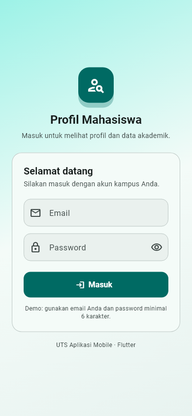
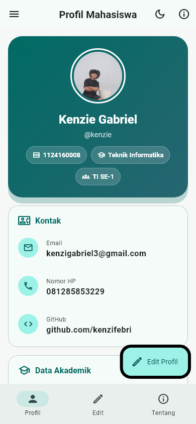
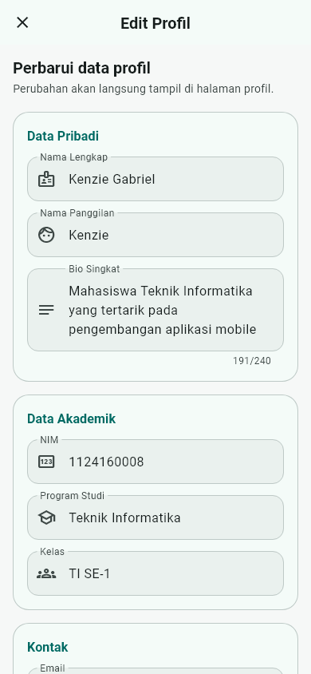
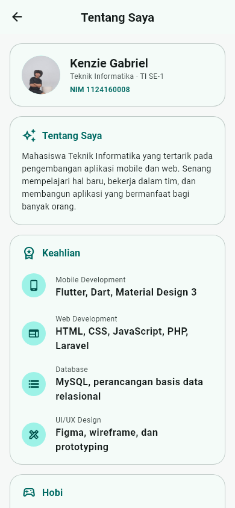
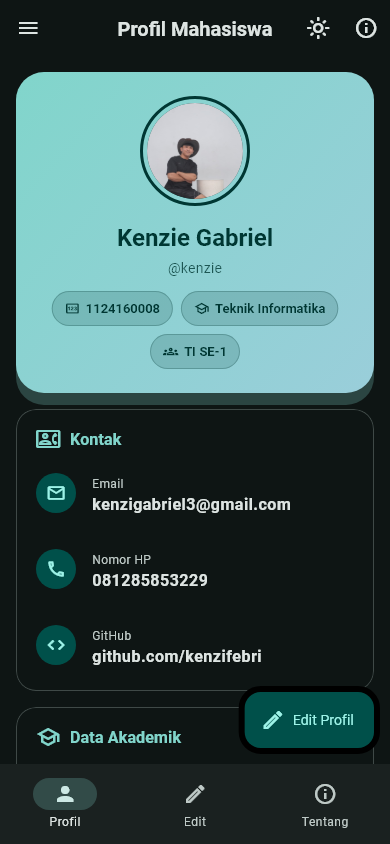

# UTS Aplikasi Mobile — Aplikasi Profil Mahasiswa

Repository ini berisi pengerjaan **Ujian Tengah Semester (UTS)** mata kuliah
**Aplikasi Mobile (Flutter)** Program Studi Teknik Informatika, Institut Teknologi
& Bisnis Bina Sarana Global.

## Identitas

| Keterangan | Data |
| --- | --- |
| Nama | **Kenzie Gabriel** |
| NIM | **1124160008** |
| Kelas | TI SE-1 |
| Program Studi | Teknik Informatika |
| Email | kenzigabriel3@gmail.com |
| GitHub | [github.com/kenzifebri](https://github.com/kenzifebri) |
| Dosen | I Ketut Gunawan |

## Link Penting

- **Repository GitHub:** <https://github.com/kenzifebri/uts-pml-1124160008>
- **Video presentasi YouTube:** [`https://youtu.be/ISI_LINK_VIDEO`](https://youtu.be/ISI_LINK_VIDEO)
  > Ganti tautan di atas dengan URL video presentasi yang sudah diunggah.
- **APK Release (v1.0.0):** <https://github.com/kenzifebri/uts-pml-1124160008/releases/tag/v1.0.0>
- **Catatan rilis APK:** [docs/RELEASE_NOTES.md](docs/RELEASE_NOTES.md)

## Screenshot Aplikasi

| Login | Profil | Edit Profil |
| --- | --- | --- |
|  |  |  |

| Tentang Saya | Mode Gelap |
| --- | --- |
|  |  |

## Struktur Repository

```text
uts-pml-1124160008/
├── soal1-live-coding/          # Soal 1 — Live Coding halaman profil (StatelessWidget)
│   ├── lib/main.dart
│   └── ...
├── soal2-profil-app/           # Soal 2 — Aplikasi Android profil mahasiswa
│   ├── assets/images/profile.jpeg
│   ├── lib/
│   │   ├── main.dart           # MaterialApp, tema, routes
│   │   ├── models/profile.dart
│   │   ├── screens/
│   │   │   ├── login_page.dart
│   │   │   ├── profile_page.dart
│   │   │   ├── edit_profile_page.dart
│   │   │   └── about_page.dart
│   │   ├── theme/app_theme.dart
│   │   └── widgets/
│   │       ├── info_tile.dart
│   │       └── profile_avatar.dart
│   └── ...
├── docs/screenshots/           # Screenshot dokumentasi
└── README.md
```

## Soal 1 — Live Coding: Halaman Profil (`soal1-live-coding`)

Aplikasi satu halaman yang **seluruh widget-nya `StatelessWidget`** (tanpa
`StatefulWidget`/`setState()`).

Fitur:

- `MaterialApp` dengan `title`, `debugShowCheckedModeBanner: false`,
  `theme`, `darkTheme`, `themeMode: ThemeMode.system`, dan `home`.
- `Scaffold` dengan `AppBar` berjudul **Profil Mahasiswa**, serta
  `FloatingActionButton` yang menampilkan SnackBar
  **"Terima kasih telah melihat profil saya"**.
- Layout `SafeArea → SingleChildScrollView → Padding → Column` sehingga aman
  dari overflow.
- `CircleAvatar` berisi inisial, nama, NIM, dan program studi menggunakan
  hierarki `Theme.of(context).textTheme`.
- Widget reusable `InfoTile` dengan konstruktor `const` dan properti `final`
  (`icon`, `label`, `value`), dipakai pada 2 Card: **Kontak (4 item)** dan
  **Hobi (3 item)**.

Cara menjalankan:

```bash
cd soal1-live-coding
flutter pub get
flutter run
```

## Soal 2 — Aplikasi Profil Mahasiswa (`soal2-profil-app`)

Aplikasi Android dengan data profil yang disimpan di memori (tanpa server).

### Fitur wajib yang sudah diterapkan

1. **Halaman Login** — `StatefulWidget`, `Form` + `validator`, validasi email,
   password minimal 6 karakter, indikator loading, dan
   `Navigator.pushReplacementNamed('/profile')`.
2. **Halaman Profil** — foto dari `assets/images/profile.jpeg` ditampilkan dengan
   `CircleAvatar`, nama, NIM, program studi, kelas, bio, serta Card kontak
   (email, nomor HP, GitHub) memakai `InfoTile`.
3. **Halaman Edit Profil** — form terisi nilai awal dari `TextEditingController`,
   validasi nama wajib diisi, email valid, dan nomor HP hanya angka 10–13 digit.
   Tombol **Simpan** mengembalikan data dengan
   `Navigator.pop(context, dataBaru)` dan halaman profil langsung diperbarui
   melalui `setState()`.
4. **Halaman Tentang Saya** — keahlian, hobi, dan riwayat pendidikan ditampilkan
   dengan `ListView`.
5. **Scaffold lengkap** — `AppBar`, `Drawer`, `FloatingActionButton`, dan
   `NavigationBar`.
6. **Tema** — `theme` dan `darkTheme` dengan warna sendiri, tombol mode gelap di
   AppBar dan switch di drawer yang langsung mengubah `themeMode`.
7. **Identitas Android** — `android:label="Profil Kenzie"` pada
   `android/app/src/main/AndroidManifest.xml`.

### Struktur kode

```text
soal2-profil-app/lib/
├── main.dart
├── models/profile.dart
├── screens/login_page.dart
├── screens/profile_page.dart
├── screens/edit_profile_page.dart
├── screens/about_page.dart
├── theme/app_theme.dart
└── widgets/info_tile.dart
```

### Cara menjalankan

```bash
cd soal2-profil-app
flutter pub get
flutter run
```

Login dapat menggunakan email apa pun yang valid dan password minimal 6
karakter (mis. `kenzigabriel3@gmail.com` / `rahasia123`).

### Build APK release

```bash
cd soal2-profil-app
flutter build apk --release
```

Hasil build berada di
`soal2-profil-app/build/app/outputs/flutter-apk/app-release.apk` dan diunggah ke
GitHub Releases dengan tag **v1.0.0**. File APK tidak di-commit ke repository.

## Pemeriksaan Kode

```bash
cd soal1-live-coding && flutter analyze
cd soal2-profil-app && flutter analyze
```

## Catatan Pengerjaan

Pekerjaan dilakukan bertahap dengan commit terpisah agar riwayat pengerjaan
terlihat jelas, mulai dari `tahap 1: MaterialApp` untuk Soal 1 hingga
penyempurnaan tampilan, dokumentasi, dan build APK untuk Soal 2.

> **Catatan:** nomor HP yang digunakan adalah `081285853229`. Ganti tautan video
> YouTube dengan URL asli sebelum dikumpulkan melalui LMS.
